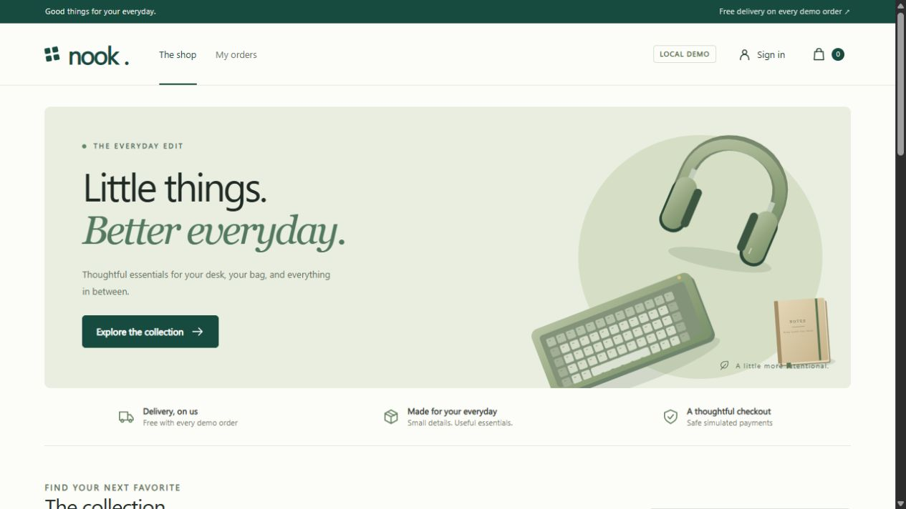
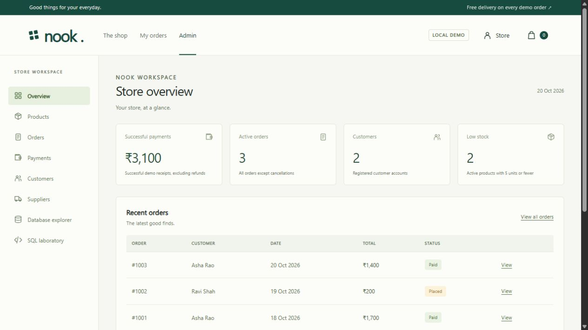

# Nook

**E-Commerce Inventory and Order Processing System**  
BCSE302L – Database Systems

Shaunak Dhar, Parneeca Mahale, and Nimisha Gaurav

A complete local demonstration with a customer storefront, a Node.js backend, and a persistent SQLite database. All assets are included. After setup, the app works without internet. Payments are simulations and do not transfer money.

## Screenshots

### Customer storefront



### Administrator workspace




## Quick start

1. Double-click **start.cmd**.
2. Keep the server window open.
3. Your browser opens **http://localhost:4173**.
4. Sign in with either demo account below, or create a customer account.

Install Node.js 24 or a compatible Node.js 22.13+ runtime from https://nodejs.org. Clone or download this repository, open the project folder, and run `start.cmd` on Windows. No `npm install` is necessary because the app has no external packages. The SQLite database and fictional sample records are created automatically on first launch.

For macOS or Linux with compatible Node.js:

```sh
node server.mjs
```

Then open http://localhost:4173. The server accepts connections from this computer only. If port 4173 is occupied by this app, use the existing server. To run a second copy on Windows, set a different port in the command window:

```bat
set PORT=4174
node server.mjs
```

## Demo accounts

| Account | Email | Password |
| --- | --- | --- |
| Customer Asha | asha@example.com | Demo@123 |
| Customer Ravi | ravi@example.com | Demo@123 |
| Administrator | admin@nook.local | Admin@123 |

The sign-in dialog also has **Customer demo** and **Admin demo** buttons. They sign in to those real seeded accounts through the authentication API.

## Features

- Browse 12 illustrated products in three categories. Search, sort, filter by category or price, and filter for stock availability.
- Open a product detail dialog. Add products to a persistent shopping cart, update quantities, or delete lines.
- Register customers, sign in, sign out, and edit a profile. Passwords use salted scrypt hashes. Sessions use HttpOnly cookies and expire after 12 hours.
- Check out with a successful, pending, or declined simulated payment. The backend reads current prices and stock itself.
- Commit order records and inventory changes together. A declined simulated payment rolls back all checkout writes and preserves the cart.
- Retrying the same checkout key returns the original order without charging or deducting stock twice.
- View order receipts and progress. Complete pending demo payments. Cancel orders before shipment to restore stock and mark successful payments refunded.
- Admin dashboard displays successful payment totals, active orders, customer counts, low stock, recent orders, and category order values.
- Admins add and edit products, stock, prices, categories, suppliers, product artwork, featured status, and shop availability. Archiving a product preserves order history. Category choices come from the three seeded categories; category management is outside this demo.
- Admins add supplier contacts and view customers and payment history.
- Admins advance paid orders to Shipped, then Delivered. Unpaid orders cannot be shipped.
- Database explorer shows all nine core entities, live records, column information, primary and foreign keys, views, indexes, and trigger definitions. Password hashes are hidden.
- SQL laboratory executes curated queries for joins, aggregates, subqueries, stock checks, integrity checks, the payment summary view, and the LineTotal function. A rollback demonstration temporarily changes stock and restores it.
- Admin **Restore demo data** requires typing RESET. It replaces practice data with the seeded baseline and signs out all sessions.

## Database and report consistency

The app retains the nine core entities from the report:

`CUSTOMERS`, `CATEGORIES`, `PRODUCTS`, `SUPPLIERS`, `SHOPPING_CART`, `CART_ITEMS`, `ORDERS`, `ORDER_ITEMS`, `PAYMENTS`.

It adds a `SESSIONS` support table for actual authentication. The app implements refinements beyond the report's initial demonstration:

- Money uses integer **paise** for exact arithmetic. A stored Price of 120000 means INR 1,200. The API also sends integer paise, and the frontend formats them as rupees. The explorer explains the unit, and reporting queries divide by 100.0.
- Customer `Role` separates administrators from customers. `PasswordHash` stores real salted hashes, replacing the report's nonfunctional markers.
- Products link to suppliers using `SupplierID` and include `Featured`, `Tag`, and `Active` for the storefront.
- Orders have a unique `CheckoutKey` to prevent duplicate checkout submissions.
- `RestoreCancelledStock` implements the cancellation enhancement. The status API blocks repeated or invalid status transitions.
- The catalog expands to 12 products. IDs 101–103 retain the report's keyboard, mouse, and notebook prices. Presentation names become Studio Keyboard, Pebble Mouse, and Daily Notebook.
- Baseline sample order 1001 is INR 1,700 and order 1002 is INR 200. Initial successful receipts total INR 1,700. Baseline stock for product IDs 101, 102, 103 is 19, 29, 48.

The schema resides in **schema.sql**. The persistent database is **data/nook.sqlite**, created automatically on first launch. The seed data lives in **src/database.mjs**. Schema creation uses `IF NOT EXISTS` for restarts, not a migration system. Back up your database before any future schema changes.

## Architecture

```text
Browser UI (public/index.html, styles.css, app.js)
    same-origin HTTP requests to /api/*
Node.js HTTP server (server.mjs)
    authentication, validation, role checks, parameterized SQL
SQLite data layer (src/database.mjs and schema.sql)
    foreign keys, unique constraints, CHECK constraints
    stock triggers, view, indexes, transaction control
Persistent local database (data/nook.sqlite)
```

The frontend uses plain JavaScript and CSS so there is no build step or package download before your demo. The backend uses Node's built-in HTTP, crypto, and SQLite modules. Images and styles stay local. Server-side authorization protects every cart, order, and admin route. SQL values use prepared statements. The server rejects cross-origin writes, restricts browser resources to the local origin, and serves files only from the public directory.

## Main API routes

| Method | Route | Purpose |
| --- | --- | --- |
| GET | /api/catalog | Public products and categories |
| GET | /api/session | Current signed-in profile |
| POST | /api/auth/register | Create a customer and cart |
| POST | /api/auth/login | Authenticate and create a session |
| POST | /api/auth/logout | Delete the current session |
| PUT | /api/profile | Update the current profile |
| GET | /api/cart | Read the current customer's bag |
| POST | /api/cart/items | Add or merge a cart product |
| PUT / DELETE | /api/cart/items/:id | Change quantity or remove a line |
| POST | /api/checkout | Atomic checkout with a unique key |
| GET | /api/orders | List the customer's orders |
| GET | /api/orders/:id | Read an owned order and receipt |
| POST | /api/orders/:id/pay | Complete a pending simulated payment |
| POST | /api/orders/:id/cancel | Cancel before shipment |
| GET | /api/admin/overview | Store statistics |
| GET / POST | /api/admin/products | List or create products |
| PUT | /api/admin/products/:id | Edit inventory and product details |
| GET | /api/admin/orders | View all orders |
| PUT | /api/admin/orders/:id/status | Advance fulfillment |
| GET | /api/admin/payments | Read the payment ledger |
| GET | /api/admin/customers | Read customer profiles and order counts |
| GET / POST | /api/admin/suppliers | List or add suppliers |
| GET | /api/admin/database?table=PRODUCTS | Browse an allowlisted core table |
| GET | /api/admin/lab?query=view | Run a curated reporting query |
| POST | /api/admin/lab/rollback | Execute a reversible stock demonstration |
| POST | /api/admin/demo/reset | Restore baseline with RESET confirmation |

JSON write requests need `Content-Type: application/json`. Error responses include an `error` string and an appropriate status code. API money fields are paise.

## Tests

With compatible Node.js:

```sh
node --test tests/app.test.mjs
```

Or double-click **test.cmd** on this laptop. Tests create separate temporary databases and do not change your demo database. The 12 integration tests cover authentication, ownership, cart changes, stock validation, successful checkout, full rollback after declined payment, concurrent requests competing for the final unit, cancellation, pending payments, fulfillment, admin validation, SQL labs, constraints, cross-origin rejection, persistence after restart, and reset.

## Demo limitations

This is a local academic demonstration. It uses HTTP on loopback and includes known demo credentials. It does not include a real payment provider, email, password recovery, tax calculation, delivery service integration, or production load testing. Product illustrations represent sample products. The single-process server uses synchronous SQLite operations, which are suitable for the classroom demo. Do not expose this local server publicly without a separate deployment and security design.

## References

- Project team, supplied nimisha ppt_merged.pdf and the accompanying project report.
- Node.js SQLite documentation: https://nodejs.org/docs/latest-v24.x/api/sqlite.html
- Node.js crypto documentation: https://nodejs.org/docs/latest-v24.x/api/crypto.html
- SQLite constraints: https://www.sqlite.org/lang_createtable.html
- SQLite triggers: https://www.sqlite.org/lang_createtrigger.html
- SQLite transactions: https://www.sqlite.org/lang_transaction.html

Original SVG product illustrations and interface icons are included in this project. No remote image or font services are required.


## Repository contents

Application source, database schema, fictional seed data, tests, and the demo guide are included. Generated SQLite databases, saved sessions, local runtime binaries, and environment files are excluded. Each clone starts with its own database.

GitHub stores the source code. Run the full Node.js and SQLite application locally using the instructions above. GitHub Pages cannot run this backend.
